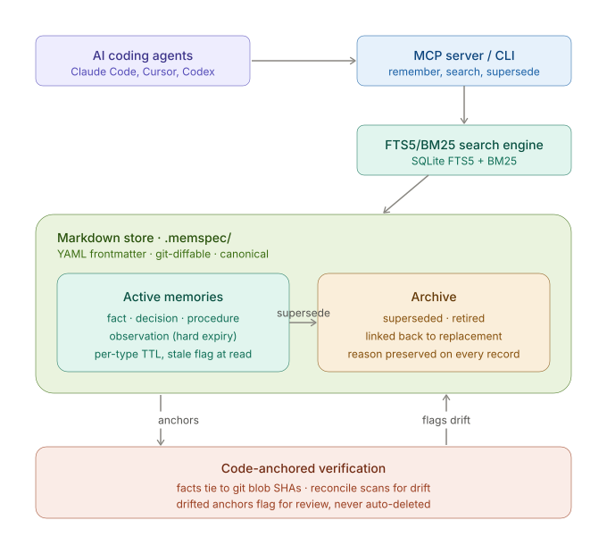

# Memspec

**Memspec is Git-backed project memory for AI coding agents, with verification and drift detection.** Claims about code are anchored to file SHAs; when the code changes, memspec flags the claim for review instead of letting facts rot silently. Duplicate rejection, typed supersede chains, and per-claim provenance turn memory into testable claims, not a notes file.

Markdown files under `.memspec/` are the canonical source of truth: human-readable, git-diffable, greppable. Lose the index, lose speed — not data. No backend service. No hosted memory API. No vendor lock-in.

## Architecture

<p align="center">
  
</p>

Agents `remember` claims and `observe` notes; everything lands as markdown under `.memspec/`. From there a structured layer — lifecycle (`active → superseded → retired`), code anchors, typed links, and temporal validity — feeds FTS5/BM25 search, the MCP server, and session-start hooks, so the next session wakes up with the right context instead of amnesia.

## Features

- **File-canonical.** Memories are markdown files with YAML frontmatter. Human-readable, git-diffable, greppable. Lose the index, lose speed — not data.
- **Three claim types + observations.** `fact`, `decision`, `procedure` with per-type TTLs; `observation` for point-in-time notes with hard expiry.
- **Lifecycle, not curation.** `active | superseded | retired`. Corrections create a new memory linked back to the original; supersede chains preserve the reason on every record involved. Past TTL = stale flag at read time, never deletion.
- **Code-anchored verification.** Tie memories to git blob SHAs. When code drifts, memspec flags drifted anchors for review instead of letting facts about code rot silently. `verify --reanchor` re-baselines a claim that still holds, keeping the old SHAs as history. Anchors are file-grain today: on an active repository most alarms are false (measured in [BENCHMARK.md](BENCHMARK.md)), so treat a drift flag as "review this", not "this is wrong".
- **Linked notes** (v0.5+). Records reference other records by id (`refines`, `supports`, `depends_on`, `derived_from`, `conflicts_with`, `supersedes`, `superseded_by`). Search can follow these links one or more hops to surface neighbours alongside direct matches; `--include-superseded` lets link-following reach archived predecessors (v0.6+).
- **Temporal validity** (v0.5+). Optional `valid_from` / `valid_to` per memory. Search with `--as-of <iso>` filters by world-state truth window, orthogonal to the `check_by` review schedule.
- **Operator-tier storage** (v0.4+). Records sourced by the operator land in a separate filesystem path with stricter overwrite protection (`--override-operator` required to supersede). Write authority comes from the channel: no MCP call can create, modify, re-anchor, merge into or retract an operator record, and an operator-looking `source` sent over MCP is stored at agent tier.
- **Layered stores** (v0.6+). A project `.memspec/` and a global `~/.memspec/` merge at retrieval time — project records take priority, global merges as a lower layer. Every search, context, and MCP path honours the configured `stores:` layers. A repo without its own store can bind to external stores via a `.memspec.yaml` pointer file (v0.9+).
- **Scope claims** (v0.9+). Stores declare which working directories they own; ingestion routes knowledge to the claiming store and holds unclaimed content local, so nothing crosses a sync boundary by default — team knowledge stays out of personal stores and vice versa.
- **Transcript ingestion** (v0.9+). `normalize` → `distill` → `reduce` turns raw harness session logs (Claude Code, Codex) into weekly experience digests; the dream pass diffs them against memory writes to catch work that happened but was never recorded. Raw transcripts never leave the machine.
- **Dedup-aware writes.** `remember` refuses near-duplicate claims (same identifiers, same wording) and points at the existing record, so memory accretes corrections via `supersede` instead of silent duplicates. A value a supersede replaced or retracted is refused if an agent writes it again over MCP (a lexical, best-effort guardrail; the limits are listed in SPEC.md).
- **FTS5/BM25 search.** SQLite FTS5 relevance, recency-weighted, ranked per profile.
- **MCP server.** Fourteen tools; setup for eleven harnesses in [docs/harnesses.md](docs/harnesses.md).
- **Open Knowledge Format.** `export --format okf` / `import --format okf` round-trip the store losslessly through Google's OKF v0.2 markdown bundles.
- **Witnessed claims.** Every memory carries `verified_with` (`anchor | operator | evidence | assertion`) — provenance, not a confidence score.
- **Dream pass** (v0.7+). Periodic reflection script (`memspec-dream`) reads the last N days of memspec writes and git log, asks an LLM to surface stale memories, supersede candidates, verify candidates, missing relations, and behavioural rules worth promoting. Output is review material, never auto-applied.
- **Zero infrastructure.** `npm install -g memspec` + `memspec init`. No accounts, no API keys, no hosted services.

## Install

```bash
npm install -g memspec
```

Or local:

```bash
git clone https://github.com/siimvene/memspec.git
cd memspec && npm install && npm run build && npm link
```

## Quick start

```bash
memspec init                                            # interactive setup, creates .memspec/

memspec remember fact "Auth uses JWT" \                 # write a claim, anchor it to code
  --source agent --tags auth --anchor src/auth/jwt.ts

memspec search "auth"                                   # BM25; --expand-edges follows linked notes

memspec reconcile                                       # find anchored claims whose code drifted
memspec verify ms_01HXK... --evidence "still JWT"       # confirm still true; refreshes timestamp

memspec supersede ms_01HXK... \                         # or replace with a corrected version
  --reason "Migrated to OAuth" --body "Now OAuth2 + PKCE"
```

The `anchor → reconcile → verify | supersede` loop is the differentiator: claims about code stay accountable to the code.

## Why not just AGENTS.md?

| Approach | Reviewable in Git | Code-anchored | Lifecycle | Search | Self-hosted |
|---|---|---|---|---|---|
| `AGENTS.md` / `CLAUDE.md` | yes | no | none | grep | yes |
| `MEMORY.md` / scratchpad | yes | no | none | grep | yes |
| Vector DB (Chroma, Qdrant) | no | no | manual | semantic | yes |
| Hosted memory API (Mem0, Letta) | no | no | hosted | hosted | no |
| **Memspec** | per-claim | yes | typed states | FTS5 + BM25 | yes |

If project memory fits in a paragraph in a single file, `AGENTS.md` is fine. Memspec is for when memory grows into a list of claims that need to track code reality, expire, supersede, and link to each other.

## Memory model

Three claim types plus observations, agent-operated, lifecycle handled in the tool:

| Type | Captures | Default TTL |
|---|---|---|
| `fact` | Verified project state | 90d |
| `decision` | A choice with rationale | 180d |
| `procedure` | A reusable workflow | 90d |
| `observation` | Point-in-time, hard expiry | 7d |

Each memory is one markdown file with YAML frontmatter. Past `check_by` → `stale` flag at read time, never deletion. `memspec sweep` is the only removal path, operator-approved one item at a time.

States: `active | superseded | retired`. Corrections create a new memory linked back to the original; supersede chains preserve the reason on every record involved. Everything lives in git history.

## Linked notes

Records reference other records by id in their frontmatter — `refines`, `supports`, `depends_on`, `derived_from`, `conflicts_with`, `supersedes`, `superseded_by`. Search can follow these links to surface neighbours alongside direct matches:

```bash
memspec search "v0.5 plan" --expand-edges --expand-depth 1
```

Follows the listed ids one hop out and includes the linked notes in results. Each surfaced neighbour carries `expanded_via` showing how it got there. `--include-superseded` lets expansion reach archived predecessors via supersede chains. `--as-of <iso>` filters by `valid_from` / `valid_to` for world-state queries.

### Derived vs observed (`derived_from`, v0.11)

`derived_from` marks a record as *inferred* from other records rather than observed directly — a conclusion, not a measurement. A record carrying any `derived_from` edge is `derived: true` in search/`get` JSON, and its search hit's header carries a `(derived)` marker in CLI/MCP text. Like the other positive edges it cannot coexist with a `conflicts_with` to the same target. See [Search](#search) for how `derived` affects `coverage_witness`.

```bash
memspec remember fact "The cache layer is the bottleneck" --source claude-code \
  --derived-from ms_01AAA… --derived-from ms_01BBB…
```

### Compared, independent (`distinct_from`, v0.13)

`distinct_from` records that you compared two records and they are independent claims: neither contradicts, refines, supports nor depends on the other. It exists to acknowledge an overlap `memspec check` flagged (see below). It is not a retrieval edge, so search expansion and lineage never follow it, and it cannot sit next to any other edge between the same two records (whichever record carries either one).

```bash
memspec relate --from ms_01AAA… --to ms_01BBB… --type distinct_from
```

## Merge-time contradiction check (`memspec check`, v0.13)

A team store shared through pull requests never gets a git conflict (one file per record), so two records that contradict each other can merge a week apart. `memspec check` runs in CI on the PR branch and fails when the change set adds or edits an active claim that plausibly overlaps another active claim with no recorded relation between them:

```bash
memspec check                      # vs the merge-base with origin's default branch
memspec check --base main --json   # explicit base, JSON report
memspec check --all                # audit every active claim (no git needed)
```

- **What is checked:** records that are new at the merge-base, were not active claims there (a revived archive record), or whose title, body, set of anchored files, type, validity window or scope changed (working tree and untracked files included). Frontmatter-only edits (verify, tags, added edges, anchor sha refresh) don't count, so a triage PR doesn't surface pre-existing pairs. Removing an acknowledgement or a `conflicts_with` does count: an `unrelate`d edge, a question group that drops or loses an answer, a deleted copy of a record that carried the edge.
- **What overlaps:** a shared anchored file, or one record's text naming a file the other is anchored to, plus 2+ shared distinctive title terms; or 3+ shared title terms with an overlap of at least 0.5. Any type against any type.
- **What clears a finding:** either record lists the other in `refines`, `supports`, `depends_on`, `derived_from` or `distinct_from`, or a question group lists both. A `conflicts_with` between two active records, carried by either one, is itself a finding (`declared_conflict`) when either file changes: supersede one or file both in a question group. So is a `supersedes` naming a record that is still active (`unapplied_supersede`): archive the target (`state: superseded`, `superseded_by`), or let `memspec supersede` do it in that store. In a team store that is the promote PR that copied a local survivor but not the target's retirement.
- **Invalid files:** a changed record file that does not load (bad frontmatter, non-YAML front matter such as `---js`, which is refused and never evaluated), any duplicate record id in the store, a changed symlink, or a record naming one target in `distinct_from` and another edge list. Git mode refuses outright (exit 2) a store with a symlink at its root or under `memory/`, `observations/` or `archive/`, and a store whose record files git does not track (gitignored, or the wrong `--store`).
- **Exit codes:** 0 clean, 1 findings (overlaps, declared conflicts, unapplied supersedes, invalid files), 2 usage or git error. The text output ends with the commands to resolve the first finding.

### Running the check in CI

The check diffs against a merge-base, so the job needs the history: check out with full depth (`fetch-depth: 0`). The default GitHub checkout is depth 1; there the merge-base cannot be found and the check exits 2, failing closed rather than passing. Pass the base explicitly: `origin/<base branch>` on a pull request, and the previous tip of main on a push to main (so the push run checks exactly what the push added). Exit 0 passes the job; 1 (findings) and 2 (usage or git error) fail it.

```yaml
name: memspec-check
on:
  pull_request:
  push:
    branches: [main]
jobs:
  check:
    runs-on: ubuntu-latest
    steps:
      # Pin actions by commit SHA in a real workflow.
      - uses: actions/checkout@v4
        with:
          fetch-depth: 0
      - uses: actions/setup-node@v4
        with:
          node-version: 22
      - run: npm install -g memspec@0.13.0
      - name: memspec check
        env:
          EVENT: ${{ github.event_name }}
          BASE_REF: ${{ github.base_ref }}
          BEFORE: ${{ github.event.before }}
        run: |
          if [ "$EVENT" = pull_request ]; then
            memspec check --base "origin/$BASE_REF"
          else
            memspec check --base "$BEFORE"
          fi
```

The check is only as strong as the branch protection around it: make it a required status check on main, and treat a PR that edits the workflow itself as a change to the gate.

## Actuation boundary (`requires_human`, v0.11)

A procedure can flag steps only a human may perform. An unattended runner reads `requires_human` and refuses those steps instead of executing them. It is a procedure-only field (a schema error elsewhere). A non-empty `requires_human` also carries through to search hits (JSON `requires_human`; CLI/MCP text prints a `requires human: …` line under the hit) and `memspec_get`, so a runner sees the constraint without a separate lookup.

```bash
memspec remember procedure "Rotate the signing key" --source human:siim \
  --requires-human "approve the rotation in the console" \
  --requires-human "confirm the new key in the HSM"
```

## Evidence attachments (`--evidence`, v0.11)

Attach committed proof to a claim. A local file is copied, content-addressed, into `<store>/evidence/<sha256>/…` (refused over 5 MB, from the machine-local `local/` subtree — checked on real paths, so a symlinked parent directory doesn't slip past — or when the path itself is a symlink: pass the real file); an `http(s)` URL is recorded as a pointer and never fetched. A file-backed attachment witnesses an anchorless claim as `evidence` — stronger than a bare assertion. `verify --evidence-file <path>` attaches the same way, but only on a clean verification: a `needs_review` result copies nothing. `remember` validates every input (all evidence paths, dates, edge targets, the answered question) before the first copy, so a refused write never leaves an orphan under `evidence/`. The entry's `source` field is provenance, never an absolute path: `~/…` for a file under your home directory, `<repo>:<path>` inside a git checkout, otherwise omitted (the basename is in `name`).

```bash
memspec remember fact "p99 latency is 40ms under 2k rps" --source claude-code \
  --evidence ./bench/2026-09-11.json --evidence https://grafana.internal/d/abc
```

The `evidence/` directory is committed (not gitignored): it holds public/derived artifacts only. Secrets belong in the untracked `local/` subtree, which `--evidence` refuses to copy from.

## Question groups (v0.11)

When two or more records answer one named question, group them instead of wiring pairwise `conflicts_with`. A **closed** question (its listed answers are the only candidates) resolves by elimination: once every answer but one is superseded/retired, `status` reports the survivor. Resolution is never automatic — you confirm it.

```bash
memspec question "Which DB backs the ledger?" --source siim --answers ms_01AAA… ms_01BBB… --closed
memspec remember fact "Ledger uses Postgres 16" --source siim --answers-question ms_01QQQ…
memspec question ms_01QQQ… --resolve     # once one answer survives
```

Question records never carry `state: active`, so they're invisible to a plain `memspec search` — the normal query pipeline is built on the active-only FTS pool. `--type question` (MCP `type: "question"`) is the dedicated path: it lists question records directly instead of ranking them, open groups first, then resolved (each group newest-first); a query filters by a case-insensitive substring match against the title. Hits carry `closed`, `answers`, `state`, and `resolved_by` alongside the usual fields.

```bash
memspec search "ledger" --type question         # or: memspec search "" --type question for all of them
```

## Code-anchored verification

Calendar TTL is the wrong signal for facts about code. Memspec ties claims to file SHAs:

- `memspec anchor <id> <files...>` — record the git blob SHAs of the files this memory depends on
- `memspec verify <id>` — refresh "still true"; drifted anchors flag for review without mutating the memory
- `memspec reconcile` — scan all anchored memories for drift, including uncommitted edits

Anchor paths may be **absolute** (preferred), project-relative, or repo-qualified (`repo/path`). Prefer absolute paths when the store's project root is not the repo you're working in — a home-rooted personal store's project root is `$HOME`, so a bare `src/x.ts` resolves nowhere and the claim silently degrades to an unanchored assertion. For a repo-relative path to a sibling checkout, pass `--anchor-root <dir>` (`anchor_root` over MCP). A path that resolves nowhere is reported back, never silently dropped.

**Which form gets recorded.** A file that belongs to the same git repo as the store's project root (or to no repo) is recorded project-relative and repo-less. A file inside a *different* git repo is always recorded as `{repo: <basename>, file: <repo-relative>}` — even when it also lies under the project root. That is the personal-store case: `$HOME/git/kvart/src/x.ts` becomes `{repo: kvart, file: src/x.ts}`, which resolves on every machine the store syncs to, where a `git/kvart/src/x.ts` form would read as drifted the moment the repo lived somewhere else. On read, `repo` is looked up as a sibling of the project root, then under each `anchors.repo_search_paths` entry in `config.yaml` — **defaulting to `~/git` when none is configured** (set the list explicitly, e.g. `[~, ~/git]`, on a machine whose checkouts live elsewhere). `repo` must be a bare directory name: a record carrying an absolute or traversal `repo` reads as `repo_unavailable` / `anchor_unchecked`, never as a probe of that directory. When a write records a `{repo, file}` anchor that this store could not resolve on read, the result says so and names the directory to add to `repo_search_paths`.

Drifted memories never auto-archive. They surface for human judgement via `memspec status`.

## Search

SQLite FTS5 full-text + BM25, recency-weighted per profile. Zero setup beyond `better-sqlite3`.

Index rebuilds on demand from the markdown files. Lose the index, lose speed — not data. Parsed records are cached per file (mtime, size, inode), so a long-lived MCP server does not re-read the store on every query.

Matching is tiered: records carrying every query term rank first; when they fill less than a page, records carrying only some of the terms are added below them, never above. A query with one word the right record lacks still finds it.

Every result set carries a **coverage** verdict so an agent can tell "the store knows nothing here" from a low-ranked hit: `none` (no active record matches; with a narrowing `--type` filter the note names the filter and how many records of other types do match), `weak` (fewer than half of the distinct content-bearing query terms occur in the best-covered hit, or that hit is a partial-term match carrying under three quarters of them, or a title/tag-only match, or the best full-term match is barely above the BM25 floor — don't infer from rank; the note names which terms matched nothing), or `ok`. The term test uses the index tokenizer, so `remootio, hubitat, gate` and `"remootio relay" hubitat` count like their bare words, `tariffs` matches `tariff`, `gate` does not match `gateway`, and function words (`does the ... use`) are ignored; in a layered store the hit judged is the best-covered one, not whichever layer won the rank-1 tiebreak. Weak/ok notes name the active scope when one is set. A `coverage_witness` names the strongest witness behind the hits (`anchor > operator > evidence > assertion`), so coverage `ok` with witness `assertion` reads as "claimed, but unverified"; a drifted or unchecked anchor counts as `evidence` and the line says so (`best witness: evidence (drifted)`). A **derived** hit (any `derived_from` edge — see "Derived vs observed" above) counts one tier weaker than its own `verified_with` when `coverage_witness` is computed — e.g. `evidence` reads as `assertion` — because the record's own witness only attests to how the inference step was checked, not to the ground truth its premises rest on; `assertion` is already the floor and stays `assertion`. The CLI prints a final `Coverage:` line; `search --json` and MCP return the same payload object (`query`, `count`, `results`, `coverage`, `coverage_note`, `coverage_witness`).

Anchored results are drift-checked on the read path: a record whose anchored file has changed since it was last anchored prints a `[DRIFTED]` marker (JSON/MCP: `drifted`, with `anchor_unchecked` when the anchor's repo is not checked out here). No `reconcile` run needed to see it. An anchor reads as drifted only when its recorded blob matches neither the working-tree file nor the file on the anchored repo's remote default branch (`origin/HEAD`, else `origin/main`, else `origin/master`, from local refs as of the last fetch). So a checkout on a feature branch does not drift records anchored to main, and a record anchored on that branch a moment ago is not drifted either (the working tree, which `reconcile` and `anchor` hash, still matches). Each `drift` entry's `compared_to` says what was compared: `worktree+origin/main`, or `worktree` when the repo has no remote default ref or the file is gitignored. A symlinked anchor is looked up on the ref by its target path, matching how it was hashed. `status`'s drift count, boot `context` and `verify` use the same rule, and the same `anchors.repo_search_paths`; `verify`'s note names any anchor that held only on the default branch (this checkout's copy differs). `reconcile` keeps working-tree semantics: it answers what this checkout changed.

## Usage receipts & outcomes

Every search hit is logged to a local, gitignored `usage.jsonl` — one row per result, carrying the query (truncated to 200 chars), the hit's rank, which surface issued it (`cli` | `mcp` | `context`), and a session id when one exists: `MEMSPEC_SESSION_ID`, else `CLAUDE_SESSION_ID`, else `mcp:<pid>` inside the MCP server (one process per client connection, so the process is the session). A bare CLI invocation with none of those carries **no** session — there is deliberately no per-process fallback, because an id that changes on every call would make two searches in one agent turn count as two sessions. Rows without a session never contribute to `sessions`, so Promotion candidates require real session ids (the `status` text says so). Boot context (`memspec context`, the session-start hook) logs the records it surfaces with surface `context`, so a pinned record that boots every session is never reported cold. In a layered store each row lands in the store that owns the record, so a read-only team layer accumulates its own receipts. Search hits and `memspec_get` results carry `last_referenced` / `sessions` back to the caller when known — read-only derivations, never written to frontmatter.

Retrieval alone doesn't say whether a memory actually helped. `memspec outcome <id> <useful|dead_end|corrected> [--note] [--source]` (CLI + `memspec_outcome` MCP tool) appends a durable, append-only receipt to `outcomes.jsonl` without ever mutating the record. `supersede` records a `corrected` outcome automatically for every id it collapses — you don't have to call it yourself when you already know a claim was wrong. Record `dead_end` whenever a retrieved memory turned out wrong or useless for the task at hand; it feeds `status`'s two usage-derived surfaces:

- **Cold** — active records created more than 30 days ago that have never been retrieved, or weren't retrieved in the last 60 days. Candidates for `memspec supersede` or a closer look, not automatic removal.
- **Promotion candidates** — active observations, and facts witnessed only by `assertion` and created in the last 14 days, that have been retrieved in 2+ distinct sessions with zero `dead_end` outcomes. Candidates only — nothing is auto-promoted.

Both sections print in `memspec status` text output and surface as `cold` / `promotion_candidates` arrays in the MCP `memspec_status` JSON.

## Trust profiles

Memspec doesn't enforce a write policy; the agent's instruction file does (see [AGENTS-ADDON.md](AGENTS-ADDON.md)). Two reference profiles:

**Operator solo** (default). The agent writes facts, decisions, procedures, and observations freely. Duplicate rejection, anchor drift, and supersede chains catch bad writes. Friction-free; relies on `git log` to undo mistakes. Suits single-operator setups where memspec is your own agent infrastructure.

**Team review.** For shared repos with multiple writers:

- Observations: agent writes freely.
- Facts: agent writes only when anchored to code; anchorless facts route to a PR for review.
- Decisions: drafted by agent, merged by human.
- Procedures: agent-written, reviewed at first use.
- Operator-tier claims: never overridden without `--override-operator` and a reason in the supersede record.
- Secrets: never stored. Anywhere. Ever.

Pick the profile in your `AGENTS.md` / `CLAUDE.md` and the agent will follow it. The store records every write, so deviations show up in `git log`.

## MCP server

```bash
memspec-mcp                          # stdio in current project
memspec-mcp --cwd /path/to/project   # pin a root
```

`memspec init` auto-creates `.mcp.json` for host tool discovery (Claude Code, Cursor, etc).

Fourteen MCP tools: `memspec_search`, `memspec_get`, `memspec_remember`, `memspec_supersede`, `memspec_relate`, `memspec_unrelate`, `memspec_observe`, `memspec_verify`, `memspec_outcome`, `memspec_question`, `memspec_anchor`, `memspec_reconcile`, `memspec_status`, `memspec_export`. The CLI exposes a superset (`init`, `migrate`, `sweep`, `context` are CLI-only — store creation, schema migration, physical removal, and session-start context are operator acts, not an agent surface).

Setup for Claude Code, Codex CLI, Cursor, OpenCode, Gemini CLI, GitHub Copilot (VS Code and CLI), Windsurf, OpenClaw, Hermes, pi and Antigravity, with each harness's config path and session-start hook: [docs/harnesses.md](docs/harnesses.md).

For manual `.mcp.json` setup:

```json
{
  "mcpServers": {
    "memspec": { "command": "memspec-mcp", "args": ["--cwd", "/abs/path/to/project"] }
  }
}
```

## Global store

`~/.memspec/` is a cross-project memory layer for personal preferences, common patterns, infra knowledge. When both stores exist, the project store takes priority; global merges as a lower layer.

```bash
memspec init ~/.memspec   # same as --cwd ~/.memspec: a .memspec path is the store itself
```

## Store resolution

Every command resolves which store to use from `--cwd` (defaulting to the process cwd) by **walking up the directory tree**: the first ancestor holding a `.memspec/` directory (or a `.memspec.yaml` pointer) is the store. A session started three directories deep in a repo, or in a repo with no store of its own, resolves the nearest real store instead of a phantom empty `<cwd>/.memspec`.

The walk is fenced, and the `.memspec/` walk and the `.memspec.yaml` pointer walk share **the same fence** (so `search`, which honours pointers, and `status`, which does not, always agree on the store):

- **Inside `$HOME` it stops at `$HOME` (inclusive).** A home-rooted `~/.memspec` is found; nothing above `$HOME` is ever consulted — a `.memspec/` or pointer file in `/Users` or `/home` cannot capture a session.
- **Outside `$HOME` it walks to the filesystem root**, as memspec always did before 0.11: a repo at `/srv/app`, `/opt/x`, or a container's `/work` resolves `/srv/app/.memspec` from any subdirectory.
- **`MEMSPEC_NO_WALK=1` disables it** entirely: only cwd itself is checked (a `.memspec/` or pointer file right there still applies); otherwise `<cwd>/.memspec` is used verbatim.
- **A nearer `.memspec/` directory beats a farther `.memspec.yaml` pointer** — the closest store to cwd wins.
- **A pointer file is only honoured when it can be trusted**: one that sits in a world-writable directory (`/tmp`, a shared scratch dir) or is owned by another user is ignored with a stderr note and resolution continues as if it were absent. A `.memspec/` directory says where you are; a pointer *redirects* reads and writes to whatever path its author chose, so it has to be yours.
- An explicit store path (one that already ends in `.memspec`, e.g. `MEMSPEC_ROOT=~/.memspec` or `--store global`) is used as-is and never walked.

**Scope derives from the original cwd, not the resolved store.** When the walk climbs from `repo/service/api` up to `repo/.memspec`, the active `scope` is still computed from `repo/service/api` against the store's `scopes:` map — so a session in a subdirectory is scoped correctly rather than left unscoped.

**Writes follow the same layers as reads.** When the resolved store's `config.yaml` (or a pointer file) declares `stores:`, a write from that cwd targets the single writable layer — or the one named by `--store <name>` — never the walked-up store itself unless it is one of the layers. Relative `path:` entries resolve against the directory that holds the config that declared them, not against the caller's cwd. Zero writable layers refuses; several writable layers without `--store` refuses as ambiguous; `--store` naming a `writable: false` layer refuses. `memspec question` resolves its store exactly the same way and never creates a store as a side effect.

**Missing layers are reported, not dropped.** A configured layer whose directory is absent on this machine (not cloned yet, typo, moved) is still skipped for reads, but the composite now carries `layers_unavailable: [name]` and a warning naming the path, so a `coverage: none` can say "the team layer isn't here" instead of "the store is empty".

**Stale layer checkouts are reported too.** A layer whose directory sits in a git checkout that is behind its remote default branch (at least one commit on it not reachable from HEAD; local refs, as of the last fetch; nothing is fetched) comes back as `layers_stale: [{name, path, branch, default_branch, behind}]` with a `Warning:` line under `Coverage:` (record and `--type question` searches alike), and as `## Layers stale` in `memspec status`. The branch alone does not count: a detached CI checkout at `origin/main`, or a branch that contains main, is not stale. Bring the checkout up to date with its default branch (merge or check it out) and the warning goes away. The default branch is `origin/HEAD` when it resolves, else `origin/main`, else `origin/master`; if upstream renamed its default branch, run `git remote set-head origin -a` after a fetch so `origin/HEAD` names the new one.

`init` **refuses** to create a store nested inside an existing one (a `.memspec/` already exists up the tree, `~/.memspec` included) and exits 1 naming the parent store; pass `--force` to create the nested store deliberately.

## Multi-store: pointer files & scope claims

Different orgs lay memory out differently — store beside the code, store in a sibling team repo, one personal umbrella. Two declarations make any layout explicit and keep knowledge from leaking across store boundaries:

**Pointer file.** A repo with no store of its own carries a `.memspec.yaml` at its root binding it to the stores that serve it (paths resolve against the pointer's directory; a `.memspec/` directory closer to cwd always wins):

```yaml
# service-repo/.memspec.yaml — memory lives in the sibling team repo
stores:
  - name: team
    path: ../platform-team-specs
    priority: 10
    writable: true
  - name: personal
    path: ~/.memspec
    priority: 0
    writable: true
```

Reads fan out across the layers. Writes must be unambiguous: with more than one writable layer in scope, `remember` refuses until you say `--store team` or `--store personal` — a silently-guessed store is how team knowledge ends up in a personal repo.

**Read-only layers (`writable: false`).** A layer marked `writable: false` is included in every read but refuses every write. A write with no explicit `--store` never selects it, and an in-place edit of a record it owns — `supersede`, `relate`/`unrelate`, `verify`, `anchor` — refuses, naming the layer:

```
"ms_01K…" lives in read-only store layer 'kvart-team' (…); it cannot be modified here.
```

An explicit `--store kvart-team` write also refuses. This is how a personal store layers a shared team store it should read but never mutate.

**The `layer` field.** A search hit or `memspec_get` result served from a non-primary layer carries `layer: <name>` in JSON, and the CLI/MCP text appends a `(layer: <name>)` suffix. Hits from the primary (writable) layer carry no `layer` — single-store retrieval stays byte-identical.

**Recipe: a personal store layers a read-only team store.** Add a `stores:` block to the personal store's own `config.yaml`, pointing at the team store by absolute path (`~` and absolute paths both work):

```yaml
# ~/.memspec/config.yaml
stores:
  - name: personal
    path: ~/.memspec          # writable primary
    priority: 0
    writable: true
  - name: kvart-team
    path: /Users/siim/git/kvart-team-context/.memspec   # read-only team layer
    priority: 10
    writable: false
```

```console
$ memspec search "meter reading" --limit 3
[decision] Meter reading estimation from historical data … (assertion) (layer: kvart-team)
  ms_01KQ5S73FHC7582BZEBFBVYMXJ | 2026-04-26 | siim
…
```

Team records surface with `(layer: kvart-team)`; `remember` without `--store` lands in `personal`; any edit of a team record refuses.

**Scope claims.** A store's `config.yaml` declares the working directories whose knowledge it owns:

```yaml
claims:
  - ~/work/platform/**
  - ~/git/my-project
```

Ingestion (`memspec reduce`) routes each session's digest to the claiming store. Sessions nobody claims are **held local** — they never cross a sync boundary, and route automatically the day a claim appears. No claims configured anywhere = classic single-store behaviour.

## Record scoping

A store shared across several projects (a home-rooted personal store, or one shared repo store) can partition records by working directory so a query issued while working on one project doesn't surface another's noise:

```yaml
scopes:
  kleidia: [~/git/kleidia, ~/git/kleidia-docs]
  plg: ['~/piletilevi/**']
```

A record's `scope` is absent (visible from every scope — the default), `universal` (explicitly visible everywhere), or a name from the map above (visible only when that scope is active). `remember`/`observe`/`search` all accept `--scope`, or derive it from `cwd` against the patterns above.

Set `scopes_require: true` in `config.yaml` to make this mandatory: `remember`/`observe` then refuse a write that resolves no scope at all (no `--scope` passed, cwd matched no pattern) rather than letting it land unscoped. Pass `--scope universal` for a record that genuinely belongs everywhere — that's the explicit opt-out, not a workaround.

Records written before scoping existed (or written since without a scope) can be backfilled from their tags: `node bin/repair-scope-backfill.mjs --store <root> --map tag:scope,tag:scope,...` (dry-run by default; `--apply` writes, with an undo journal). Records whose tags match two different scopes are left untouched and reported ambiguous; records matching nothing are left untouched and counted; operator-sourced records are skipped unless `--include-operator`.

## Store layout

```
.memspec/
  memory/
    facts/  decisions/  procedures/        # active, agent-tier
    operator/{facts,decisions,procedures}/ # operator-tier (separate path)
    questions/                             # question groups (v0.11)
  observations/                            # raw, unclassified
  evidence/                                # committed evidence attachments (v0.11)
  archive/                                 # superseded + retired
  config.yaml                              # decay, profiles, scopes, stores
  .gitignore                               # usage.jsonl, outcomes.jsonl, local/, logs/ — telemetry, never memory
```

The `.gitignore` is written by `init` and kept current on every write: a store created before 0.11 gets `outcomes.jsonl`, `local/` and `logs/` appended on its first 0.11 write (only the missing lines, under a short comment), so `git add -A` in a synced store never picks up per-machine telemetry.

Frontmatter fields per record: `id`, `kind` (`claim | observation | question`), `type`, `state`, `source`, `source_kind`, `verified_with` (`anchor | operator | evidence | assertion`), `tags`, `check_by`, `anchors`, `supersedes`, `superseded_by`, `conflicts_with`, `refines`, `supports`, `depends_on`, `derived_from`, `distinct_from`, optional `requires_human` (procedures), `evidence`, `answers` / `closed` / `resolved_by` (questions), `valid_from` / `valid_to`. Human-readable, git-diffable, greppable.

## CLI reference

| Command | What |
|---|---|
| `memspec init` | Create `.memspec/`, install hooks |
| `memspec remember <type> <title> --source <who>` | Write a fact/decision/procedure |
| `memspec observe <text>` | Capture a point-in-time observation |
| `memspec search <query> [--expand-edges] [--include-superseded] [--as-of <iso>]` | Search; optionally follow linked notes |
| `memspec context [--query] [--limit]` | Token-budgeted memory dump for session-start hooks |
| `memspec supersede <id> --reason "..." [--body] [--merge-from <ids>]` | Replace, retract, or merge records |
| `memspec relate --from <id> --to <id> --type <kind>` | Wire a link between records after the fact (`refines\|supports\|depends_on\|derived_from\|conflicts_with\|distinct_from`) |
| `memspec check [--base <ref>] [--all] [--store <dir>] [--json]` | Merge-time overlap check: fail when a change set adds or edits a claim that overlaps another with no recorded relation, so the overlap gets reviewed in the PR (exit 0/1/2). It flags compatible claims about as often as contradictions; a `refines`/`distinct_from` edge records the review |
| `memspec question <title\|id> [--answers <ids>] [--closed] [--add\|--close\|--open\|--resolve]` | Create or edit a question group (competing answers; closed questions resolve by elimination) |
| `memspec verify <id> [--evidence "..."] [--check-by <iso\|never>] [--reanchor]` | Mark a memory still true; checks anchors; `--check-by` pins the next review date explicitly instead of resetting to the type default |
| `memspec outcome <id> <useful\|dead_end\|corrected> [--note] [--source]` | Record what happened after a retrieved memory was acted on (append-only; never mutates the record) |
| `memspec anchor <id> <files...>` | Link a memory to file SHAs |
| `memspec reconcile` | Find anchored memories with drifted code |
| `memspec normalize [--source <harness>]` | Session logs → local trajectory records (deterministic, local-only) |
| `memspec distill [--limit <n>]` | Trajectories → per-session digests via a cheap LLM |
| `memspec reduce [--force]` | Per-session digests → committed experience digest, routed by claims |
| `memspec status` | Health readout (counts, witness, stale, drift, conflicts, cold records, promotion candidates) |
| `memspec sweep [--dry-run] [--answers <file>]` | Interactively retire stale items (operator-only removal path); `--answers` reads `<id>\t<y\|n>` lines non-interactively instead of prompting |
| `memspec export --format <jsonl\|graphml\|dot>` | Export records and links to stdout |
| `memspec export --format okf --out <dir>` | Export the store as an [Open Knowledge Format](https://github.com/GoogleCloudPlatform/knowledge-catalog) v0.2 bundle (one document per record, evidence blobs included, memspec-only fields under `x-memspec`) |
| `memspec import --format okf <dir> [--trusted]` | Import an OKF bundle. Trust is re-derived by default (no operator tier, no pins, witness recomputed from what can be re-checked here); `--trusted` keeps the bundle's trust fields for your own backups |
| `memspec migrate` | v0.2/v0.3 → v0.4+ store migration (idempotent, dry-run by default) |

## Agent harnesses

Memspec is not tied to one agent. `memspec init` wires it into **every harness it knows about and can detect**, and `--harness` overrides that choice:

```bash
memspec init                          # auto-detect what is installed
memspec init --harness cursor,gemini  # force a specific set
memspec init --harness none           # store only, wire nothing
memspec init --harness generic        # unknown harness: get the contract written out
```

| Harness | What init wires |
| --- | --- |
| `claude` | Two hooks in `$CLAUDE_CONFIG_DIR` or `~/.claude`, registered in that directory's `settings.json` |
| `cursor` | `.cursor/mcp.json` server entry + `.cursor/rules/memspec.mdc` (`alwaysApply: true`) |
| `gemini` | `.gemini/settings.json` server entry + `GEMINI.md` instruction block |
| `codex` | Marked block in the project's `.codex/config.toml` (Codex loads it for trusted projects; the user-level `~/.codex/config.toml` is never touched) + `AGENTS.md` |
| `hermes` | `AGENTS.md` instruction block (skipped with `--skip-patch`) + an MCP block written to `.memspec/harnesses/hermes.yaml` to paste into `~/.hermes/config.yaml` |
| `generic` | `.memspec/harnesses/generic.md`, the three-surface integration contract |

An unknown harness id is an error, not a silent skip — a typo that quietly installs nothing is the failure worth refusing.

Two rules keep this safe on a real machine:

- **JSON is merged, never regenerated.** Cursor and Gemini configs are read, one key is added, and every other key and server is preserved.
- **TOML and YAML are never round-tripped.** `.codex/config.toml` gets a marked block appended only when neither the block nor a hand-written `[mcp_servers.memspec]` table is present, and `~/.hermes/config.yaml` is never written at all: a hand-maintained file carries comments and ordering that a programmatic re-serialisation destroys, so memspec writes the block out for you to paste instead.

### Context injection for any harness

Hooks are a Claude Code concept. Any other harness gets the same effect with one command at session start:

```bash
memspec context --format markdown   # ranked, budgeted memory for this project
memspec context --format json       # structured, for programmatic use
```

Point your harness's session-start mechanism at it and put stdout in the system prompt. It exits 0 with empty output on an empty store, so it is safe to call unconditionally. `.mcp.json` in the project root already carries the MCP server entry, so a harness that reads the MCP discovery file needs no further wiring.

Everything above is configurable in `.memspec/config.yaml`. Pass `--no-install-hooks` to skip harness wiring entirely.

### Hooks for Claude Code

For `claude`, init installs two hooks into the Claude Code config directory: `$CLAUDE_CONFIG_DIR/hooks/` when that variable is set, `~/.claude/hooks/` otherwise, and registers them in that directory's `settings.json`. Run it with the same `CLAUDE_CONFIG_DIR` your sessions use (an absolute path, as Claude Code requires; a relative or `~` value is refused); for several config directories, run it once per directory. A plain `node <~/.claude copy>` registration there is repointed to the directory's own copy; a wrapper, chained command or any other path is left alone:

- `memspec-session-start.js` — runs `memspec context` and injects memory into the session prompt so the agent doesn't have to remember to search; also surfaces unreviewed dream passes (counts + open questions) until a `_Reviewed:` marker lands (v0.8+)
- `memspec-consolidate.js` — on commit, prompts the agent to write memories about what just shipped

See [`hooks/`](hooks/) for the scripts.

## Dream pass

A periodic reflection over the store. Reads the last N days of memspec writes + git log, asks an LLM to surface stale memories, supersede / merge candidates, verify candidates, missing typed relations, and behavioural rules worth promoting to your agent instruction file. **Proposals only — never auto-applied.**

```bash
memspec-dream                          # weekly default (7 days, current .memspec/)
memspec-dream 14                       # custom window
MEMSPEC_DREAM_AUTOCOMMIT=1 memspec-dream
```

Output lands at `<store>/dream/YYYY-MM-DD.md` for a human to review. Defaults to invoking `claude` (Claude Code CLI) headlessly; override with `MEMSPEC_LLM_BIN` and `MEMSPEC_LLM_ARGS` for other CLIs.

Cron example (Sunday 22:00 local):

```cron
0 22 * * 0  cd /path/to/project && MEMSPEC_DREAM_AUTOCOMMIT=1 memspec-dream
```

Inspired by [Aaron Fulkerson's Exo](https://aaronfulkerson.com/2026/05/23/meet-exo/) and the [`dream-skill`](https://github.com/grandamenium/dream-skill) prior art.

## Transcript ingestion

The dream pass can only consolidate what sessions bothered to write down. Transcript ingestion closes that gap by distilling what sessions actually *did* (v0.9+):

```
memspec normalize   # harness logs -> trajectory records   (deterministic, 0 tokens, local/)
memspec distill     # trajectories -> per-session digests   (cheap LLM, incremental, local/)
memspec reduce      # digests -> experience digest           (deterministic, committed, claim-routed)
```

- **normalize** reads Claude Code (`~/.claude/projects/`) and Codex (`~/.codex/sessions/`) session logs into trajectory-v1-shaped records (after [Letta's Trajectory](https://www.letta.com/blog/trajectory/) format; own implementation). Adapter per harness — adding one is a small PR.
- **distill** runs each session through a cheap model (`MEMSPEC_DISTILL_BIN`/`MEMSPEC_DISTILL_ARGS`, default `claude --model haiku -p`) into a ~250-word digest: what happened, decisions, fixes, discoveries, loose ends. Incremental with a per-run cap, so a heavy week never becomes one un-fittable batch. Secret shapes are redacted.
- **reduce** merges fresh digests into `<store>/digests/<date>-<hostname>.md` — the only artifact that gets committed. Raw transcripts, trajectories, and per-session digests stay in the gitignored `local/` and never leave the machine.
- The **dream pass** then reads experience digests alongside memspec writes and reports `UNRECORDED WORK`: things that demonstrably happened but produced no memory — with ready-to-run `memspec remember` proposals.

Scheduling is wall-clock-free by design: run all three from any wake-driven daily job (macOS launchd fires missed slots on wake; `distill` and `reduce` self-gate). Laptops that were off simply catch up on next wake — data is delayed, never lost.

## Docs

- [SPEC.md](SPEC.md) — design rationale and frontmatter schema
- [SCHEMA.md](SCHEMA.md) — generated field reference (regenerated from Zod via `npm run schema`)
- [CHANGELOG.md](CHANGELOG.md) — release history
- [MIGRATION-v0.3.md](MIGRATION-v0.3.md) — v0.2/v0.3 → v0.4+ upgrade path
- [AGENTS-ADDON.md](AGENTS-ADDON.md) — block to paste into `AGENTS.md` / `CLAUDE.md` if `init` couldn't patch your repo

## License

MIT
